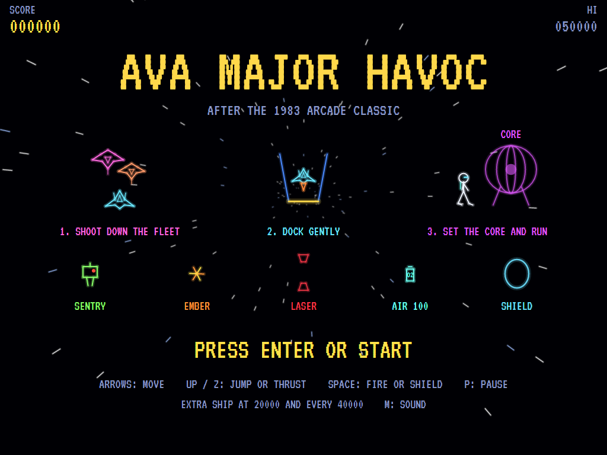
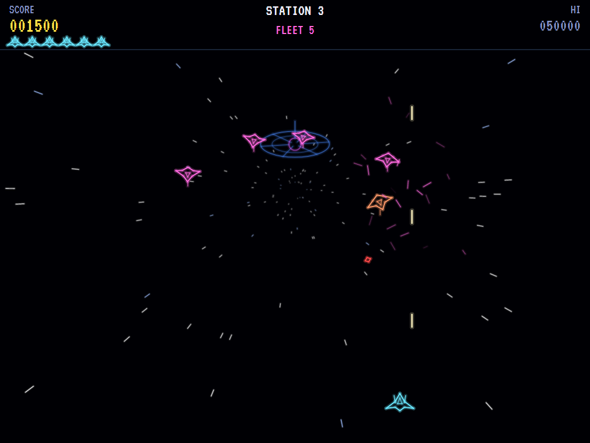
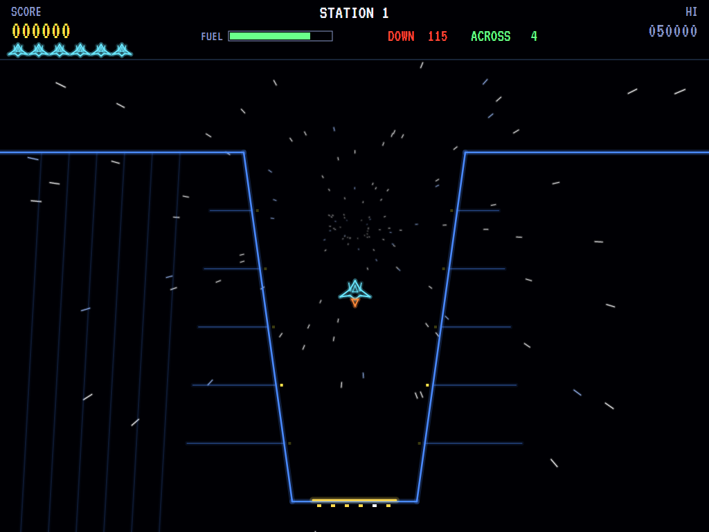
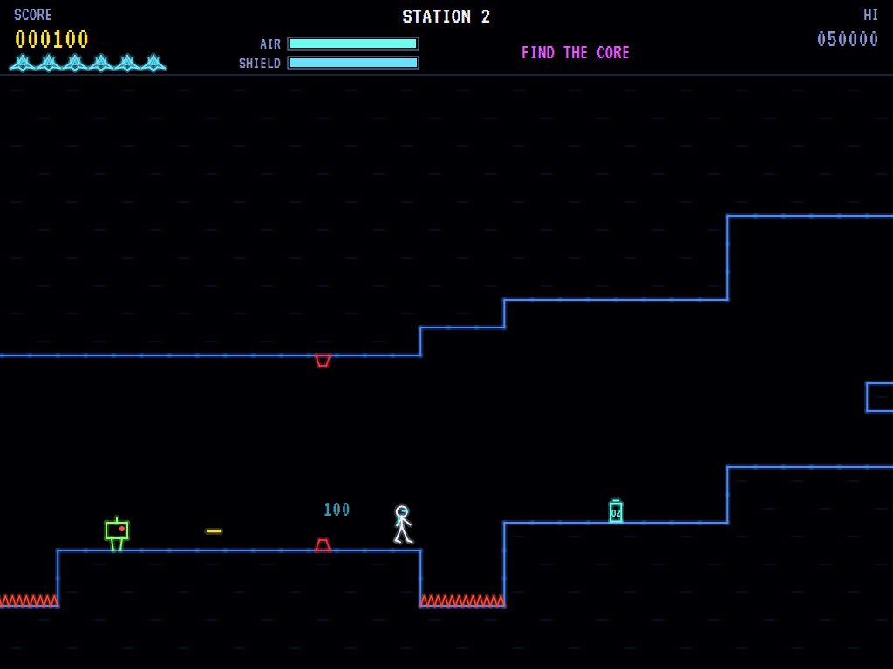
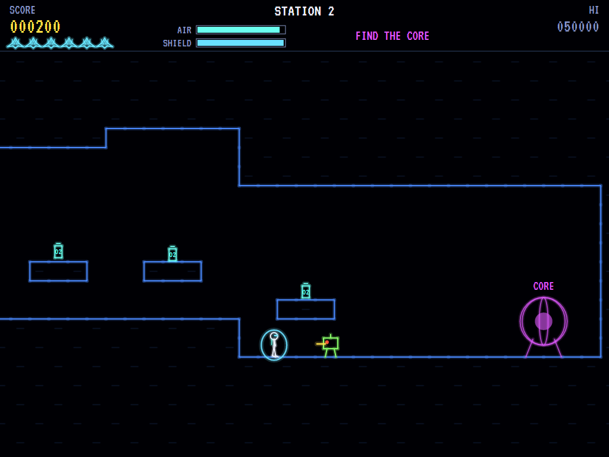
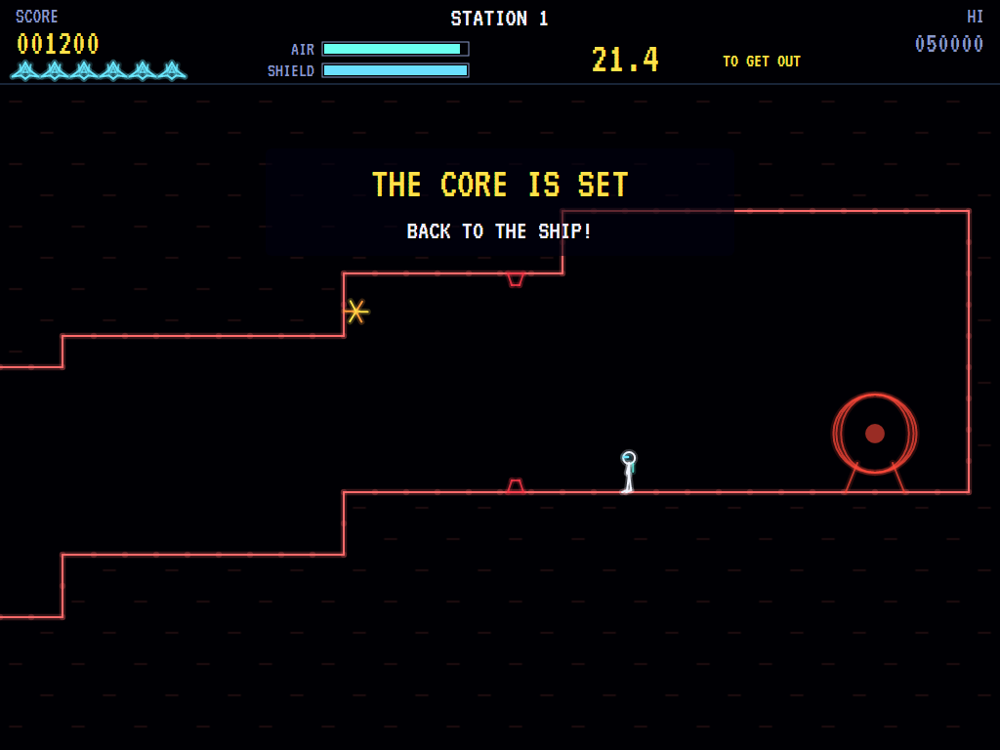
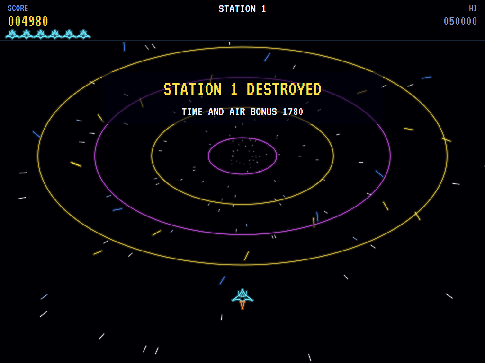
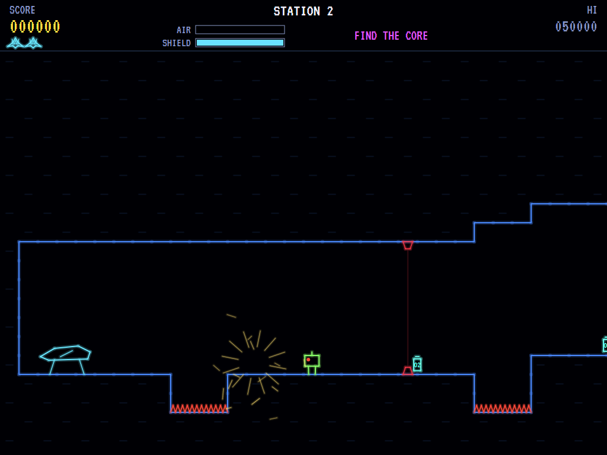
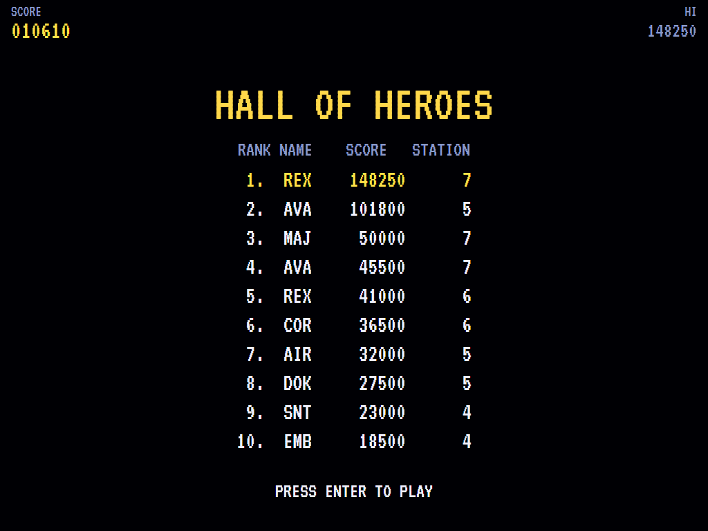

# AVA Major Havoc

[](https://github.com/Harlock123/AVAMajorHavoc/actions/workflows/build.yml)

A colour vector adventure in the style of Atari's 1983 arcade game **Major Havoc**, built with .NET 10
and Avalonia UI. Every station is three games in one: shoot down the fleet that guards it, bring your
fighter down gently onto its landing pad, then go in on foot. Run, jump and shield your way through the
maze to its core, set it to blow, and get back to the ship before it does.

## Features

- **1. The fleet**:
  - **Your fighter** slides along the bottom of the screen and fires up into the fleet, three shots at a time.
  - **The Stingrays** wheel round the distant station in a ring that breathes in and out. Now and then one peels off and dives at you, weaving and firing, then climbs back to its place. A diver is worth double.
  - **Clearing the fleet** takes you on to the docking.
- **2. The docking**:
  - **Coming down:** the station's pull drags the fighter down. Thrust against it and steer into the mouth of the bay, which narrows down to the pad.
  - **Landing:** touch down on the pad slowly enough, straight down and not sliding across. The score bar shows your speeds in green when they're safe.
  - **Crashing:** touching the walls, landing too hard or missing the pad wrecks the ship.
  - **The fuel left** is paid as a bonus.
- **3. The maze**, on foot:
  - **Havoc** runs and jumps through floors that step up and down, with pits and spikes between them and platforms to climb.
  - **Air** runs out as he goes. Air canisters along the way top it up.
  - **The shield** protects him from everything but spikes while you hold the button. It burns quickly and recharges slowly.
  - **Sentries:** robots pacing their stretch of floor, firing along it at Havoc in front of them.
  - **Embers:** fireballs bouncing about the passage.
  - **Lasers:** beams across the passage that switch on and off.
  - **The core:** waits at the far end. Touch it and the countdown starts, so run back to the ship before it blows.
  - **Checkpoints:** lose Havoc and he comes back at the start of the last floor he reached, with fresh air.
  - **Every maze** is made from the station's number, so a station's maze is always the same. Every step can be climbed back, so the way out is always there.
- **The escape**: the station blows up behind you, paying a bonus for the time and air left, and the next station is a little bigger and faster.
- **Scoring**:

  | | Points |
  |---|---|
  | Stingray | 150 (300 diving) |
  | The whole fleet | 500 |
  | Docking | 10 for each unit of fuel left |
  | Air canister | 100 |
  | Setting the core | 1,000 |
  | Getting away | 100 for each second left, 10 for each unit of air, and 2,000 times the station |

  - **Extra ships** come at 20,000 and every 40,000 after that.
- **Sound**:
  - **The title tune:** an original bold march in C minor.
  - **The effects:** the laser, explosions and the shriek of a diver, the thruster and the clunk of docking, footsteps, the shield's hum, lasers zapping, the core's alarm, the station's boom, and its hum.
  - All of it is synthesised and mixed by OpenAL.
- **Attract mode**: leave the title alone for 15 seconds and the computer plays a station: the fleet, the docking or (most often) the maze. It jumps steps, pits and Sentries, waits out the Lasers, and raises the shield when it must.
- **A top-ten high-score table** with arcade-style initials entry. It records the station reached.
- **Gamepads** through SDL2, as well as the keyboard.
- **Any window size**: the screen scales to fit, letterboxed. **Ctrl+S** saves a screenshot.
- **One self-contained executable** per platform: Windows, macOS and Linux on Intel/AMD and ARM.

## Screenshots

| The title | The fleet | Docking |
|:---------:|:---------:|:-------:|
|  |  |  |
| Three games in every station. | Stingrays round the station. | Down into the bay. |

| The maze | The shield | The core is set |
|:--------:|:----------:|:---------------:|
|  |  |  |
| Pits, spikes, and a Sentry. | Past a Sentry behind the shield. | Back to the ship! |

| The escape | Lost | The high scores |
|:----------:|:----:|:---------------:|
|  |  |  |
| The station goes up. | Out of air. | The hall of heroes. |

The screenshots are made by the tests, which play the game in a real (headless) window; see
[Tests](#tests).

## Download and run

Ready-to-run builds for Windows, macOS and Linux, on both Intel/AMD and ARM, are on the
[Releases page](https://github.com/Harlock123/AVAMajorHavoc/releases/tag/latest). **Latest build** is
rebuilt on every push to `main`. Each download is one self-contained executable: no .NET install is
needed.

| Platform | Archive |
|---|---|
| Windows | `AVAMajorHavoc-win-x64.zip`, `AVAMajorHavoc-win-x86.zip`, `AVAMajorHavoc-win-arm64.zip` |
| macOS | `AVAMajorHavoc-osx-arm64.tar.gz` (Apple silicon), `AVAMajorHavoc-osx-x64.tar.gz` (Intel) |
| Linux | `AVAMajorHavoc-linux-x64.tar.gz`, `AVAMajorHavoc-linux-arm64.tar.gz`, `AVAMajorHavoc-linux-arm.tar.gz` |

```bash
tar -xzf AVAMajorHavoc-linux-x64.tar.gz     # or linux-arm64, linux-arm, osx-arm64, osx-x64
./AVAMajorHavoc
```

On Windows, unzip and run `AVAMajorHavoc.exe`. On macOS, if Gatekeeper refuses to open it, run
`xattr -d com.apple.quarantine AVAMajorHavoc` once. Run with `--no-audio` for silence.

**Sound** comes through OpenAL Soft, built in for every platform. In a virtual machine the game
detects it and uses a larger audio buffer, so the sound doesn't break up.

**Gamepads** use SDL2, which is bundled for Windows, macOS and Intel/AMD Linux. ARM Linux builds need it
installed; without it the keyboard still works:

```bash
sudo apt install libsdl2-dev            # Debian / Ubuntu / Raspberry Pi OS
sudo pacman -S --needed sdl2-compat     # Arch / Omarchy
```

## Controls

| Input | Action |
|-------|--------|
| **Enter** | Start |
| **Left** / **Right** (or **A** / **D**) | Move |
| **Up** / **W** / **Z** | Jump (in the maze), thrust (docking) |
| **Space** / **X** / **Ctrl** | Fire (in space), the shield (in the maze, hold) |
| **P** / **Esc** | Pause (Esc again to quit) |
| **M** | Mute |
| **Ctrl+S** / **Cmd+S** | Save a screenshot to the Pictures folder |

**Gamepad**: left stick or D-pad to move, **A** to jump or thrust, **X**, **B** or the right trigger to fire
or shield, **Start** to start and pause, **Back** (while paused) to quit.

**Entering initials**: type letters, or dial with **Up**/**Down** and accept with **Space**; **Left** /
**Backspace** go back; **Enter** finishes.

## Tests

```bash
dotnet test AVAMajorHavoc.slnx
```

The engine has no UI and runs in fixed 60 Hz steps, so it plays the same at any frame rate, and a seed
always plays the same game. The tests check:

- **The fleet:**
  - the fighter sliding and firing three at a time
  - Stingrays shot down, and divers worth more
  - the ring turning, and divers diving and firing
  - the fleet carrying on after a ship is lost
  - on to the docking when it's gone
- **The docking:**
  - the pull and the thrust
  - a gentle landing on the pad, and a hard one, a sliding one and a missed one
  - crashing into the bay
- **The maze:**
  - every maze walkable both ways
  - running, and jumping about three tiles high
  - the rock
  - air running out and canisters topping it up
  - Sentries, the shield burning and recharging, and Sentry shots
  - Lasers on and off
  - Embers bouncing
  - spikes through the shield
  - the core, the escape and its bonus, and too slow
  - checkpoints
- **The machine:** bigger stations, extra ships, the attract cycle, the computer destroying the first station, the same game from the same seed, and pausing

The screenshot tests draw the real screen in a headless window. To refresh the README's pictures:

```bash
HAVOC_SHOTS=$PWD/Images dotnet test tests/AVAMajorHavoc.Tests --filter ScreenshotTests
```

To see how the computer player gets on, station by station (for tuning):

```bash
HAVOC_PROBE=1 dotnet test tests/AVAMajorHavoc.Tests --filter PilotProbe --logger "console;verbosity=detailed"
```

## Building

```bash
dotnet build AVAMajorHavoc.slnx
dotnet run --project src/AVAMajorHavoc
```

Needs the .NET 10 SDK. The sounds are made by `tools/make_sounds.py` (standard-library Python):
`python3 tools/make_sounds.py` rewrites `src/AVAMajorHavoc/Sounds`.

## Project structure

```
AVAMajorHavoc/
├── AVAMajorHavoc.slnx
├── src/AVAMajorHavoc/
│   ├── Engine/
│   │   ├── GameEngine.cs        # States, the title and demo cycle, and the station's hum
│   │   ├── GameEngine.Play.cs   # The fleet, the docking, Havoc in the maze, the core, the escape,
│   │   │                        # and scoring
│   │   ├── ShipPilot.cs         # The computer player, for the demonstration (and the tests)
│   │   ├── Entities.cs          # The fighter, the Stingrays, the bay, and each station's maze
│   │   ├── HighScoreTable.cs, InitialsEntry.cs
│   │   ├── InputHandler.cs, ControllerManager.cs  # Keys and an SDL2 gamepad
│   │   └── SoundManager.cs      # Effects and the tunes through OpenAL
│   ├── Audio/                   # The OpenAL engine (from the author's AVABand)
│   ├── Views/                   # Space, the bay, the maze, Havoc, the score bar and screens
│   └── Sounds/                  # The synthesised effects and tunes
├── tests/AVAMajorHavoc.Tests/   # Gameplay, screenshot and probe tests
├── tools/make_sounds.py
└── Images/                      # Screenshots
```

## About and licence

AVA Major Havoc © 2026 Lonnie Watson, under the [MIT License](LICENSE).

*Major Havoc* © 1983 Atari; the name belongs to its current owner. AVA Major Havoc is an independent,
unofficial game in its style. Its stations, mazes and fleets, its Stingrays, Sentries, Embers and Lasers,
its graphics, sounds, tunes and code are its own; nothing is taken from the arcade machine's program,
graphics, sound or music. It is not affiliated with or endorsed by any rights holder.
